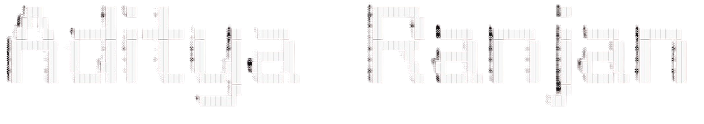
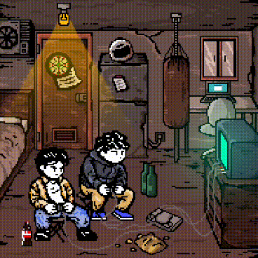

  

 

## 🚀 About Me

<table>
<tr>

<td width="65%">

  

Currently exploring Retrieval-Augmented Generation (RAG), LangChain, vector databases, and embeddings while trying to understand how modern LLM applications work under the hood. I enjoy turning concepts into projects, learning something new every day, pixelated art, and a good cup of tea ☕

* 🌍 Based in Pune
* 🔬 Building AI projects and experimenting with RAG pipelines
* ✉️ You can contact me at [ai.adityaranjan@gmail.com](mailto:ai.adityaranjan@gmail.com)
* 🧠 Currently learning Agentic AI and advanced LLM workflows

</td>

<td width="35%" align="center">

</td>

</tr>
</table> 

---

🛠️ Skills

<table width="100%">
<tr>

<td valign="top" width="33%">

💻 Languages

</td>

<td valign="top" width="33%">

⚡ Frameworks & AI

</td>

<td valign="top" width="33%">

🗄️ Databases

</td>

</tr>

<tr>

<td valign="top" width="33%">

🤖 AI & Agentic Systems

  
  
  

</td>

<td valign="top" width="33%">

🛠️ Tools & DevOps

</td>

<td valign="top" width="33%">

</td>

</tr>
</table>

## 💼 Profiles & Links

## 🔥 Contribution Journey

  

## 🌌 Activity Dashboard

  

  

